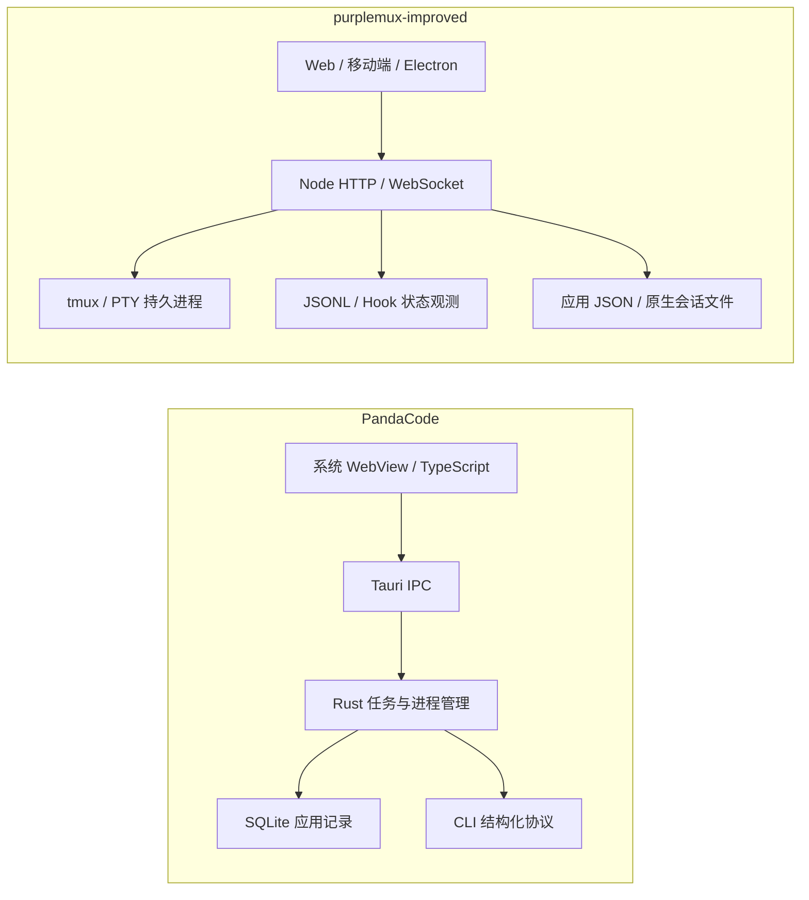

# PandaCode 借鉴调研

日期：2026-10-21。范围：产品、交互设计、架构、性能与工程验证。

## 1. 结论

**最值得借鉴的是任务验收闭环和细粒度资源治理。保留我们的远程、多端、tmux 持久会话架构，在现有能力上补齐体验。**

推荐先做三件事：

1. 测量并约束超长单轮会话：限制单次读取、传输和实际挂载量，保留继续读取能力。
2. 将已有工作状态、工具活动、变更入口组合成清晰的“待我验收”体验。
3. 建立可复现的 UI 样例和性能场景，让流式更新、重连、长消息及移动端回归可重复验证。

随后考虑每轮变更快照、页面元素反馈、Provider 能力声明。暂不建议重写为 Tauri/Rust、替换 React，或扩张到完整云沙箱/机器人平台。

### 研究口径

| 对象 | 本次读取的版本 | 提交 |
| --- | --- | --- |
| PandaCode | `0.3.12` | `48c4de0874299172777e19ed347a75fc0f80851c` |
| purplemux-improved | `0.5.9` | `20de762f52dcb09c19d5a95b0e431dc784317968` |

- 两边开始调研时工作树均干净；PandaCode 仅作只读研究。
- 读取了产品文档、关键源码、测试及我们的相关增量规格。文末给出证据索引，`P` 指 PandaCode，`U` 指我们。
- 查看了 PandaCode 仓库的 Conversation、Board 截图；它们由浏览器 fixture 生成，不能作为真实模型执行或原生运行证明。我们查看的状态菜单截图同样是已有组件验证产物。
- 本次实际运行六个 PandaCode 纯逻辑测试文件，32 个用例通过。未启动其原生应用，未做双方等负载 CPU/RSS/时延比较，未验证真实 Provider 调用。
- 文中“建议”“风险”“预期收益”均为分析；源码常量不是测量结果，历史验证文档不是本次运行结果。

## 2. 产品定位与真实差异

PandaCode 的主要对象是 **Task**：选择项目和模型、执行、审阅、完成，并将浏览器、文件、Git、团队挂到任务上。我们以 **Workspace / Tab / Session** 管理持续运行的开发环境，同时已有独立的工作阶段和会话组织能力。[P1、P2、U1、U2]

| 方面 | PandaCode | 我们当前的基础 | 借鉴判断 |
| --- | --- | --- | --- |
| 工作阶段 | Pending / In progress / Review / Completed，看板与对话共用任务 | 已有四阶段、人工优先、Workspace 汇总、Chat 状态菜单 | 补看板或待验收视图，不新建状态系统 |
| 持久执行 | 普通 Agent 按轮运行，通过原生 session ID 恢复；部分 Claude 预热 | tmux 保活，断开浏览器可继续；已有闲置页签回收 | 保留我们长运行、远程接入优势 |
| Provider | 多 CLI；Claude stream-json、Codex app-server、ACP、Pi RPC | Claude/Codex Provider 抽象，终端驱动与 JSONL/Hook 观测 | 学习协议归一化与能力发现，谨慎扩展 |
| 排队与纠偏 | Enter 排队，快捷键 steering；不同 Provider 降级 | 已有排队、立即提交、会话绑定及发送回执处理 | 已有能力，改进能力提示与可理解性即可 |
| Worktree / 交付 | 任务 checkout、GitHub 关联、本地合并入口 | Worktree 管理、同步、清理、GitHub/GitLab 草稿与确认推送 | 不重复开发；增强任务侧导航 |
| 变更审阅 | 按轮保存有归属依据的不可变 patch | 当前 Git diff、提交历史、工具修改记录 | 每轮持久变更是有价值的增量 |
| 搜索 | 当前线程文本高亮、跨格式匹配、打开折叠内容 | Sessions 支持标题、路径、ID、历史 prompt/result 查询 | 补“线程内定位”，明确与会话搜索的区别 |
| 浏览器反馈 | 元素选择、截图附到当前任务，Run 脚本与预览相连 | Electron browser bridge、截图/eval/网络、设备模拟及文件 Web 预览 | 重点补用户反馈路径，复用已有底座 |
| 资源与成本 | Core RSS、Agent/terminal 数量、用量账本、Token saver | 整机 CPU/内存、用量统计、限额、进程管理、回收 | 借鉴资源预算与口径，不重复造监控面板 |
| 分发与访问 | 原生桌面，多系统 WebView；浏览器模式是样例 | Web/PWA/移动端/多客户端同步、Electron、远程自托管 | 我们的差异化应继续保留 |

我们已有“Agent 结束不等于任务完成”的规则；PandaCode 不是这一语义的新增来源。真正可增强的是把待验收任务、产物和下一步操作放到同一条路径上。[U2]

## 3. 产品与交互的可采纳方案

### 3.1 待验收工作台：收益高，改造相对小

PandaCode 看板只加载任务摘要，选中任务才复用对话 renderer；描述列表仅取 512 字符，详情按需加载。任务卡片依元数据变化更新，不随每个 token 更新。[P2]

建议以现有 `session-workflow.ts`、Sessions 分类和 Chat 状态入口为基础：

- 桌面增加“待我验收”入口或可选看板，显示项目、任务标题、最近结果、变更/PR/MR 入口。
- 移动端沿用单列列表或 Sheet，优先展示待回答、失败、待验收，不横向压入四列。
- 完成操作沿用现有人工优先规则；不自动关闭 Agent、合并代码或覆盖人工状态。
- 首期只展示现有 session，不引入“尚无 session 的独立任务实体”。若以后要待办草稿与 Start，再单独设计身份和生命周期。

不要照搬其“完成七天自动归档”；我们已有删除、隐藏、回收、历史索引等约定，归档不能暗中变成删除或进程终止。[U2、U5]

### 3.2 会话呈现：降低过程噪音，同时保留顺序和异常

PandaCode 将一轮的过程归到 `Worked for …`，连续工具最多五个成组，commentary 保持在对应工具之前，final answer 与错误独立显示。实际耗时与历史估算有明确区别。[P3]

我们已经有工具组、Agent 组、计划和问答卡片。建议在现有时间线组合层加强“轮次结果优先”，而不是另建一套消息组件：

1. 已结束轮次默认展示结果和变更入口，过程可展开。
2. 当前工作保留最新有效进展；错误、审批、问题不能折入不可见区域。
3. 稳定 key 保住展开状态、焦点、选择文本和工具输出滚动位置。
4. 没有可靠轮次起止证据时不制造精确耗时；临时输出到持久记录的切换不闪退或重排。

验证重点是“commentary → tool → commentary → tool → final”的顺序，以及更新中点击工具、切换会话、返回历史的稳定性。

### 3.3 每轮变更快照：最有产品价值，也最需要边界设计

PandaCode 的关键不是 diff 组件，而是 **变更归属**。[P4]

- 写入前用 `pandacode_track_files(begin)` 捕获指定文件；完成后用 capture ID 和实际写入集合冻结结果。
- Provider 的结构化编辑事件可作补充，但异步事件可能晚于真实写入，不能保证事前基线。
- 不把整仓 Git status 当成任务所有权依据；不明确、重叠或不完整的编辑会省略或标记。
- 保存的 patch 与当前工作区 diff 分离，后续外部编辑不改变历史快照；淘汰 patch 后仍保留摘要并解释详情不可用。
- 同一个 capture 窗口内，未上报的外部编辑仍难以归属；独立 worktree 才提供目录层面的隔离。

对我们的落地分两步：

1. 先在结果旁展示已有记录能证明的“涉及文件”和当前 diff 跳转，明确这是关联文件或当前目录状态，不能标成“本轮修改”。
2. 再评估通过 pmuxi 工具/协议建立写前写后捕获；数据使用 provider、session、turn、checkout、capture ID 关联，按文件/轮次/总容量限制。未知归属显示未知，不回溯伪造旧轮次快照。

这项改动要覆盖未提交旧修改、同目录并发任务、重命名、二进制、删除、符号链接、捕获超时和记录淘汰。不能只在 Agent 结束时执行一次 `git diff` 就宣布完成。

### 3.4 预览到继续修改：利用我们已有 browser bridge

PandaCode 的元素反馈包含 URL、selector、标签、有限文本和 bounds，用户可连同截图发送；排除表单值、隐藏内容等。`Run` 复用托管终端，等待就绪后打开预览，切任务会取消旧导航。[P5]

我们已有截图、页面执行、网络信息和设备模拟。因此新增重点可以是“点选页面元素 → 附入当前输入草稿 → 说明修改 → 发送”，以及结果卡片的一键打开产物。先从 Electron 实现，普通浏览器受跨域 iframe 限制时提供链接/手工截图降级，不承诺与桌面同等注入能力。[U8]

项目运行命令必须来自显式配置或项目约定，不能猜测并自动安装依赖；预览打开成功与测试通过是两种不同结果。

### 3.5 线程内搜索与上下文交接

PandaCode 使用 CSS Custom Highlight API 给现有文本节点加高亮，不插入包裹标签；支持跨 Markdown 行内格式的匹配，并自动展开命中的折叠区域。实现扫描的是当前已挂载消息，不能据此声称搜索了全部历史。[P6]

我们可在已有 Sessions 搜索之外提供“当前会话查找”：先约定搜索范围，若扩展完整历史则需要服务端查询、游标定位与加载；移动端增加显式入口。现有浏览器范围包含 Safari 15.4，必须做能力检测与降级。[U9、U1]

PandaCode 还允许更换 Provider，并把最多 200 条、64 KiB 的文本历史带入新 session；不复用另一个 Provider 的 resume ID，不转移私有推理或旧图片字节。[P10] 我们若采纳，应提供明确的“交接到另一 Agent”，关联旧会话并说明有损边界；不要把它包装成原生上下文无损迁移。

## 4. 技术方案：学习边界，避免整体替换

图只展示核心边界，未穷举可选本地服务和浏览器子视图。

### 4.1 Provider 能力与归一化事件

PandaCode 通过不同协议映射成统一 `AgentEvent`，字段涵盖 session、kind、text、request、tool 等；模型目录从实际 CLI 查询，显示名称与调用 ID 分离，查询失败保留 default/custom model。[P7]

我们已经有 `IAgentProvider`，包含检测、启动/恢复、runtime snapshot、hook 翻译等能力。适合做的增量是显式声明模型发现、steering、图片、审批、计划模式、原生会话恢复等能力，UI 据此展示，不再因为 Provider 名称相似而假定相同语义。[U10]

如果评估结构化执行，先对一个 Provider 做可选 adapter 实验，并保留终端驱动路径；检查 resume 身份、用户原生 CLI 功能、认证、工具目录、重连和后台任务是否一致。不要因 app-server 协议结构清晰就直接替换 tmux 生命周期。

PandaCode 自己的 Provider 扩展仍涉及大量字符串分支和 allowlist，`providers.rs` 有 4321 行；我们应借鉴事件语义，继续保持 Provider 模块隔离，不复制集中分支结构。

### 4.2 存储：SQLite 值得用于新索引，暂不迁移全部数据

PandaCode 用 SQLite 维护应用任务、消息、队列、变更、关联信息；开启 WAL、外键、NORMAL synchronous，schema 已至 25，按 session/message ID 游标取历史。[P8]

对我们而言，SQL 事务和索引可用于未来高频的跨会话检索或不可变快照。但现有 `workspaces.json` 与原生 Claude/Codex JSONL 有明确兼容价值。先测列表/检索瓶颈，必要时建立可重建的派生索引，原生记录仍是来源；明确文件替换、删除、版本、失效和崩溃恢复。不要将“换数据库”直接等同于“变快”。

### 4.3 生命周期：按轮退出与预热有适用前提

PandaCode 按轮结束进程，并通过 session ID 保持上下文；普通 Claude 可保留最多两个预热进程，十分钟过期。复用匹配 model、mode、effort、cwd、resume ID、instructions、tool catalog、连接模式，并用 launch epoch 防止接到旧上下文。[P9]

这适合其“按轮重启”的执行模式。我们的活跃 tmux 会话原本就保持进程，不需要给每轮增加预热进程；否则可能只增加内存。优先完善已有闲置回收与恢复耗时测量。只有未来引入按轮执行 adapter，才值得比较有/无预热的首响应时间、命中率与 Agent RSS。[U5]

另外，PandaCode 的按轮退出使 Claude 的 Monitor、ScheduleWakeup、CronCreate 等持续会话工具无法按原方式回报，它主动禁用了这些工具。该代价说明“省进程”会改变能力边界，不能作为无行为影响的性能改造。[P7、P16]

### 4.4 团队协作：可学调度约束，不急于建设新编排器

PandaCode 的团队具有文件写入范围、依赖、请求去重、checkpoint、失败先处理和事件触发复审；共享 checkout 的写入范围只是协调约定，不是文件系统隔离。它的当前文档已改为新团队默认不限并发，README 中“最多三个 worker”不能当成现状。[P16]

我们适合先增强现有多 worktree/多会话管理中的父子任务、阻塞原因与交接摘要。完整跨模型编排会增加预算、失败重试、身份隔离和停止语义，当前不宜仅为功能对齐建设。

## 5. 性能：哪些机制可以转化为具体工作

### 5.1 已核实的资源边界

| 层次 | PandaCode 源码约束 | 我们的对应现状与可采纳点 |
| --- | --- | --- |
| 持久消息页 | 最多 100 条；内容与相关元数据累计 2 MiB；显示内容截到 128 KiB | 我们按用户轮次读历史。增加超长单轮的子分页或字节窗口，同时保留完整读取能力 |
| 切换缓存 | 最多 24 个线程页；Markdown 结果最多 800 项 | 我们已有 12 会话、每项估算 2 MiB、5 分钟 TTL 的展示缓存；不重复建设 |
| 活动预览 | 最多 30 条；commentary 预览 16384 个 JS 字符，保留焦点工具与最新叙述 | 可限制当前轮次的展示量，完整历史仍可查询；不能误用作原始记录裁剪 |
| 流式绘制 | `FRAME_MS = 32`，异步防陈旧提交、只补 DOM 变化 | 我们服务端 50 ms 文件事件去抖；可测客户端分组/Markdown 更新后再决定批处理 |
| 协议输出 | 单帧 4 MiB；stderr 16 KiB；工具预览 input 4096、output 8192 的上限常量 | 我们已有 stdout 上限和 WebSocket 背压；需要审计各边界是否覆盖单个超大 init |
| 历史 patch | 单文件 256 KiB、单轮 2 MiB、保留总量 128 MiB | 新快照功能必须自带容量、淘汰和详情不可用状态 |
| 预热进程 | 最多 2 个、10 分钟、完整配置匹配 | 不用于常驻 tmux；仅作为未来按轮 adapter 的备选 |
| 前端入口 | 测试断言入口 JS gzip 小于 80 KiB | 建立与 Next 路由实际加载资源相符的预算，而不是照抄此数字 |

来源：[P4、P7、P8、P9、P11、P12、U3、U4]。表中常量是源码约束，未验证所有运行路径的整体峰值。

### 5.2 最明确的增量：超长单轮不应等于无限工作量

我们的 `readJsonlTurn` 以 64 KiB 块反向读到用户消息，避免反复解析扩大尾部；这是已有优化。但是它仍会收集整轮记录，**64 KiB 是读块大小，不是整轮容量上限**。长时间自主运行的一轮可以很大。[U3]

后续链路还有两个应测量的放大点：

- `use-timeline.ts` 持续追加 entries；`timeline-view.tsx` 对已加载分组执行 map。已有 memo、分组、按轮加载不等于 DOM 总量有界。
- `timeline-delivery.ts` 对慢客户端有 4 MiB/256 条排队限制、1 MiB 背压阈值及 10 秒恢复机制，但无拥塞的 init 明确可以大于队列预算；传输排队限制不等于单包上限。

建议先量化超长单轮，再选择轮内分页、按需工具详情、窗口化或增量分组；读取/传输上限与前端挂载上限分别设计。必须保住 UTF-8、半行 JSON、轮次边界、实时追赶、历史游标、问题卡和待确认输入，不能用简单 `slice(-N)` 丢弃可访问内容。

### 5.3 渲染策略：借思想，保持 React

PandaCode `streaming-markdown.ts` 的优点是节流、保留完成节点、异步结果版本检查和滚动锚点恢复；但每次 paint 仍调用 `markdownHtml(value)` 解析当前全部文本。它是 DOM 局部更新，不是完整的增量 Markdown 解析。[P11]

我们的 `AssistantMessageItem` 已有 React.memo，但同一条 Markdown 内容变化仍进入解析和代码高亮。建议按实测顺序优化：无关条目不重算、当前轮次增量分组、已完成代码块避免重复高亮、重型详情按需挂载。不要在 React 树内部嵌入自定义 `morph()` 争夺 DOM 所有权，也不应未测量就换 WASM 解析器。

PandaCode 的 md4c 模块虽然使用动态 import，`dom.ts` 启动后立即微任务预热解析器；因此不能将“动态 import”全部算成用户打开后才加载。

### 5.4 不可见时停止绘制，不停止业务

PandaCode 检查 document visibility 和当前视图，导航更新按帧合并，活跃时间边界使用最近到期的一次性 timer。适合借鉴给我们的复杂多面板界面。[P12]

我们的资源监控已在隐藏时停止请求，时间线也有恢复连接逻辑。应继续检查的是每个隐藏面板是否仍重复分组、Markdown 解析、轮询，而不是全局断开服务：队列发送、后台任务、状态通知和服务端记录必须继续。恢复可见后先同步，再显示可信状态。[U6]

### 5.5 Token 成本与整机性能分开衡量

PandaCode 将固定指令交给支持的 harness 作为系统前缀，并让 Token saver 在变更后及每八条消息提醒，不每条重复注入。可学“稳定前缀 + 动态最小增量”。[P7、P13]

其节省百分比是外部 benchmark 或估算，不是本项目或中文任务的实测。我们已有 RTK 使用约定；若产品化，应先记录是否启用、输入/输出/缓存 token 的真实变化和结果质量，偏好沿用服务端持久化，不能照搬其 localStorage 造成多端不同步。稳定前缀也不保证所有 Provider 均命中缓存。

### 5.6 对 PandaCode 的性能宣传保持准确口径

- Tauri 不打包专属 Chromium/Node，并不意味着没有 WebView 辅助进程或 Agent 子进程；Core RSS 不能对比我们的整机内存。
- `tests/bundle.test.mjs` 只压缩 HTML 直接引用的入口脚本；`entry.ts` 又动态加载 main/overlay。该测试不能保证实际启动依赖总量小于 80 KiB。
- Markdown 缓存限制 800 项，没有独立总字节预算；流式中间版本也会进入缓存。条目有界不代表内存很小，后续可用长输出实测验证。
- `main.ts` 3581 行、`lib.rs` 3222 行、`providers.rs` 4321 行、`storage.rs` 3453 行。少框架降低了一些运行依赖，也把状态协调和协议复杂度留在应用代码中，不能推导出整体维护成本更低。

## 6. 设计与工程方法

### 6.1 采纳信息层级，不复制装饰

从样例截图可见，PandaCode 将项目导航、主要对话、辅助 inspector 分开；输入附近明确展示项目/checkout/branch；完成结果附近直接提供变更入口。该信息组织适合我们，但图中的背景、玻璃材质和大圆角不适合直接迁移。

我们的 STYLE 明确使用低饱和语义色、平面背景，禁止 blur、渐变、阴影等装饰。推荐保持现有视觉语言，把精力放在当前工作目录、分支、运行状态、工作阶段、待处理操作的位置和层级。[U11]

PandaCode 当前 `MOTION = false`，也与它较早设计文档中的弹簧动效描述不同。可借鉴即时反馈、保持输入焦点、切换不闪白；不需要关闭我们所有有意义的加载反馈。

### 6.2 可自动验证的可访问性

PandaCode 有主题 token 对比度测试，覆盖不同 hue、明暗模式、壁纸和 23 个真实 VS Code 主题样本；本次所选测试已通过。[P14]

我们可对现有语义色建立“具体前景/背景组合”的对比度回归，优先审批、错误、禁用状态和焦点环；保留 44px 触摸入口、窄屏和大字体检查。测试 token 并不能替代实际浏览器中的透明叠色和视觉检查。

### 6.3 fixture 模式与原生验证分层

PandaCode `bridge.ts` 统一区分 Tauri invoke 与浏览器 preview，浏览器测试不用真实仓库或模型。它也维护 Chrome/WebKit 配置及固定截图场景。[P15]

我们已有组件测试和多项浏览器验证记录，可以逐步抽取可复用的时间线、队列、问题卡、长工具输出、断连和身份切换数据集。只对测试入口注入 mock transport，生产鉴权/文件访问路径不共享 fixture 开关。

需要单独保留真实服务/协议集成验证：fixture 能验证布局和异步交互，不能证明进程清理、tmux 恢复、Provider 审批或真机 WebView 可用。PandaCode 当前 CI 文件也不能被其“存在浏览器测试文件”替代，不能假定这些浏览器套件全部在每次 CI 执行。

### 6.4 文档与源码冲突也是可借鉴的反例

| 说明中的表述 | 当前核实情况 | 对我们的启发 |
| --- | --- | --- |
| 早期 design/ipc 默认 Standard/ask | `storage.rs` 的默认值为 `full`，当前 approvals 文档也写 Full access | 默认行为要以明确的当前规格、实现和测试共同约束 |
| 早期“生产无 HTTP server” | MCP host、文件预览、bot web 均有 localhost listener | 架构图应区分核心服务与按需辅助服务 |
| 设计说明描述菜单过渡动效 | `motion.ts` 已关闭动效 | 旧设计意图不当成当前体验结论 |
| README 团队描述最多三 worker | 当前团队文档描述新配置默认不限并发 | 功能范围持续扩张时要同步公开说明与资源预算 |

本次仅记录对方仓库的差异，不修改其文件。默认 Full access、自动空闲重启等产品选择不应覆盖我们已有的审批与显式升级规则。[U7]

## 7. 建议实施顺序

P0 指建议最先研究/实施的增量，不表示发现了线上故障。S/M/L 为相对改造复杂度，不是工期承诺。

| 优先级 | 建议 | 收益与接入点 | 复杂度与主要风险 | 验证成功条件 |
| --- | --- | --- | --- | --- |
| P0 | 超长单轮基线及资源上限 | `jsonl-turn-reader`、timeline delivery/hook/view | M–L；轮内分页、实时追赶与锚点一致性 | 延迟/峰值可测且可控，历史完整可访问、无重复丢失 |
| P0 | 待验收入口与轮次结果呈现 | 复用 session-workflow、NotificationPanel、timeline 分组 | M；人工状态、审批和运行状态不能混淆 | 一处找到待处理结果，问答/错误始终可达，多端状态一致 |
| P0 | 可复现 UI / 性能 fixture | 复用现有 Vitest、组件与浏览器检查 | M；样例与真实协议漂移 | 固定数据重放长消息、错误、重连、切换，能保留前后证据 |
| P1 | 每轮不可变变更快照 | session history、工具事件、pmuxi、diff viewer | L；归属捕获、磁盘预算、并发编辑 | 未知明确标记，历史 patch 不随外部改动漂移 |
| P1 | 页面元素/截图反馈到草稿 | 现有 Electron browser bridge、附件、预览 | M；跨域、敏感字段、切换竞态 | 附件归属不串会话，能力不足有明确降级 |
| P1 | Provider 能力描述 | 现有 IAgentProvider、输入/设置界面 | M；不能误报协议能力 | 不支持操作可解释，模型 ID/权限语义不被猜测 |
| P1 | 线程内查找与定位 | 已有 Sessions 搜索之外的局部能力 | M；全历史范围、Safari、折叠/分页 | 查询范围明确，定位稳定，不破坏选择与消息 DOM |
| P1 | 语义色对比度回归 | 当前主题 token 与组件场景 | S–M；透明叠色与实际背景 | 明暗、焦点、审批/错误关键组合可读，辅以视觉检查 |
| P2 | Provider 交接/会话分叉 | 会话身份和恢复导航 | L；上下文有损、来源、额外 token | 明确新 session，不伪装无损恢复，不复用错误身份 |
| P2 | 索引存储 / 按轮 adapter / 预热 | 先测量、单独做技术实验 | L；数据迁移和执行语义改变 | 只有可重复收益且兼容边界清晰才推进 |

暂不立项：Tauri/Rust 全量迁移、自研 DOM reconciliation、完整 Bots/云部署/VM/模拟器平台、壁纸/玻璃主题复制。它们有自己的产品场景，但不能直接解决我们目前的主要问题。

首批宜拆为独立需求，先取性能基线，再选择一个可量化瓶颈优化；验收入口和 fixture 可各自独立推进。共享文档与状态模型无需为“对标”改名或迁移。

## 8. 后续性能验证方案

复用现有性能规格中的生产构建、1/10/30 Tab、50/500/2000 历史会话、1/10/100 MiB JSONL 场景，补充“文件大小相同、轮次数不同”的对照。[U12]

| 场景 | 采样指标 | 正确性约束 |
| --- | --- | --- |
| 首次打开与缓存切回 | 点击到首条可读消息、p50/p95、服务端读盘/解析、客户端长任务 | 缓存可先显示，但运行状态必须重新验证 |
| 单轮含大量工具输出 | 读入/传输字节、JS heap、DOM 数、分组与 Markdown 耗时 | 能展开完整输出，审批/问题不被截断隐藏 |
| 持续输出与后台切换 | CPU、绘制次数、可见后追赶耗时 | 后台任务继续，恢复无重复或遗漏 |
| 桌面与慢速移动客户端同时订阅 | 各连接 queue 峰值、断连率、重同步字节 | 慢客户端不阻塞其他客户端或文件 watcher |
| 反复切换/关闭/重连 | 稳定后的 heap、RSS、fd、连接和 timer 数 | 区分缓存预热与持续泄漏，身份不串写 |
| 回收后恢复 | Agent 进程数、RSS、恢复首响应、失败率 | 保留原 session/cwd，不终止忙碌或等待输入任务 |

固定硬件、构建、数据、模型及输出回放节奏；分别记录服务端、渲染器、Electron 主进程、Agent/工具进程。先取得基线再设门槛，不用开发编译时间、Core RSS 或单次最好成绩代表整体性能。真实模型成本实验另行隔离，避免把模型响应随机性算成 UI 改善。

## 9. 证据索引

PandaCode 链接指向本机只读调研副本；跨机器可按上文提交在 [PandaCode 固定版本源码](https://github.com/aicodeking/pandacode/tree/48c4de0874299172777e19ed347a75fc0f80851c) 定位同路径。

| 编号 | 关键依据 |
| --- | --- |
| P1 | [README](/home/home/workspace/pandacode/README.md)、[package.json](/home/home/workspace/pandacode/package.json)、[架构研究](/home/home/workspace/pandacode/docs/research.md) |
| P2 | [看板行为](/home/home/workspace/pandacode/docs/task-board.md)、[看板实现](/home/home/workspace/pandacode/src/task-board.ts)、[storage.rs](/home/home/workspace/pandacode/src-tauri/src/storage.rs) |
| P3 | [对话呈现](/home/home/workspace/pandacode/docs/conversation-presentation.md)、[turn-activity.ts](/home/home/workspace/pandacode/src/turn-activity.ts)、[tool-activity.ts](/home/home/workspace/pandacode/src/tool-activity.ts) |
| P4 | [变更语义与预算](/home/home/workspace/pandacode/docs/turn-changes.md)、[捕获实现](/home/home/workspace/pandacode/src-tauri/src/turn_changes.rs)、[写前握手](/home/home/workspace/pandacode/src-tauri/src/turn_changes/host.rs) |
| P5 | [浏览器](/home/home/workspace/pandacode/docs/browser.md)、[运行与预览](/home/home/workspace/pandacode/docs/run-project.md)、[browser.ts](/home/home/workspace/pandacode/src/browser.ts) |
| P6 | [线程搜索](/home/home/workspace/pandacode/src/thread-find.ts) |
| P7 | [Provider 文档](/home/home/workspace/pandacode/docs/providers.md)、[协议实现及帧上限](/home/home/workspace/pandacode/src-tauri/src/providers.rs)、[权限映射](/home/home/workspace/pandacode/docs/approvals.md) |
| P8 | [SQLite 与消息分页](/home/home/workspace/pandacode/src-tauri/src/storage.rs:151)、[消息读取](/home/home/workspace/pandacode/src-tauri/src/storage.rs:1520) |
| P9 | [预热匹配和淘汰](/home/home/workspace/pandacode/src-tauri/src/providers/warm.rs) |
| P10 | [有界上下文交接](/home/home/workspace/pandacode/src-tauri/src/context_recovery.rs)、[Provider 历史作者](/home/home/workspace/pandacode/src/provider-handoff.ts) |
| P11 | [流式 Markdown](/home/home/workspace/pandacode/src/streaming-markdown.ts)、[HTML 缓存与消毒](/home/home/workspace/pandacode/src/dom.ts:91)、[流文本去重](/home/home/workspace/pandacode/src-tauri/src/providers/text_stream.rs) |
| P12 | [活动上限](/home/home/workspace/pandacode/src/main.ts:650)、[可见性调度](/home/home/workspace/pandacode/src/main.ts:900)、[线程页缓存](/home/home/workspace/pandacode/src/main.ts:1672) |
| P13 | [Token saver](/home/home/workspace/pandacode/src/token-saver.ts)、[相关测试](/home/home/workspace/pandacode/tests/token-saver.test.mjs) |
| P14 | [对比度测试](/home/home/workspace/pandacode/tests/palette.test.mjs)、[动效实际开关](/home/home/workspace/pandacode/src/motion.ts)、[早期设计](/home/home/workspace/pandacode/docs/design.md) |
| P15 | [bridge/preview 分离](/home/home/workspace/pandacode/src/bridge.ts)、[包体测试](/home/home/workspace/pandacode/tests/bundle.test.mjs)、[动态入口](/home/home/workspace/pandacode/src/entry.ts)、[CI](/home/home/workspace/pandacode/.github/workflows/ci.yml) |
| P16 | [团队调度与限制](/home/home/workspace/pandacode/docs/architect-workers.md)、[停滞检测](/home/home/workspace/pandacode/src-tauri/src/architect/watchdog.rs) |
| P17 | [默认权限](/home/home/workspace/pandacode/src-tauri/src/storage.rs:23)、[旧 IPC 说明](/home/home/workspace/pandacode/docs/ipc.md)、[MCP listener](/home/home/workspace/pandacode/src-tauri/src/providers/mcp_host.rs:82)、[文件预览服务](/home/home/workspace/pandacode/src-tauri/src/file_preview.rs:348)、[bot HTTP](/home/home/workspace/pandacode/src-tauri/src/bots/channels/http.rs) |
| U1 | [当前 README](../../../README.md)、[package.json](../../../package.json) |
| U2 | [工作状态基线](../../../.specs/v20/requirements/session-task-status.md)、[Chat 状态入口增量](../../../.specs/v22/changes/chat-session-status-edit/spec.md)、[共享状态实现](../../../src/lib/session-workflow.ts) |
| U3 | [历史加载规格](../../../.specs/v20/features/timeline-history/spec.md)、[按轮读取](../../../src/lib/jsonl-turn-reader.ts)、[时间线 Hook](../../../src/hooks/use-timeline.ts)、[时间线 View](../../../src/components/features/timeline/timeline-view.tsx) |
| U4 | [展示缓存](../../../src/lib/timeline-display-cache.ts)、[传输背压](../../../src/lib/timeline-delivery.ts)、[时间线服务](../../../src/lib/timeline-server.ts)、[Markdown 组件](../../../src/components/features/timeline/assistant-message-item.tsx) |
| U5 | [闲置回收规格](../../../.specs/v22/changes/idle-agent-tab-reclamation/spec.md)、[队列规格](../../../.specs/v20/features/queued-input/spec.md)、[Worktree 交付](../../../.specs/v20/features/worktree-sync-delivery/spec.md) |
| U6 | [服务器资源监控](../../../.specs/v22/changes/host-resource-monitoring/spec.md)、[资源请求 Hook](../../../src/hooks/use-system-resources.ts) |
| U7 | [明确授权的升级重启](../../../.specs/v22/changes/auto-upgrade-detection/spec.md) |
| U8 | [Electron bridge](../../../electron/browser-bridge.ts)、[浏览器面板](../../../src/components/features/workspace/web-browser-panel.tsx)、[生成文件 Web 访问](../../../.specs/v22/changes/ai-generated-file-web-access/spec.md) |
| U9 | [Sessions 搜索](../../../.specs/v21/features/session-search/spec.md) |
| U10 | [IAgentProvider](../../../src/lib/providers/types.ts)、[Codex Provider 规格](../../../.specs/v19/features/codex-provider-core/spec.md) |
| U11 | [视觉规范](../../STYLE.md) |
| U12 | [性能基线与分轮优化规格](../../../.specs/v20/requirements/performance-optimization.md) |

仓库 LICENSE 为 MIT 加 fork 署名条款，并非标准 MIT 原文。此次未复制对方实现或素材；后续若直接复用代码或资产，应按其 [LICENSE](/home/home/workspace/pandacode/LICENSE) 和 vendored 依赖各自许可处理。

本次执行命令、检查结果与限制见[调研验证记录](../../../.specs/v22/changes/pandacode-research/result.md)；需求范围见[调研规格](../../../.specs/v22/changes/pandacode-research/spec.md)。
